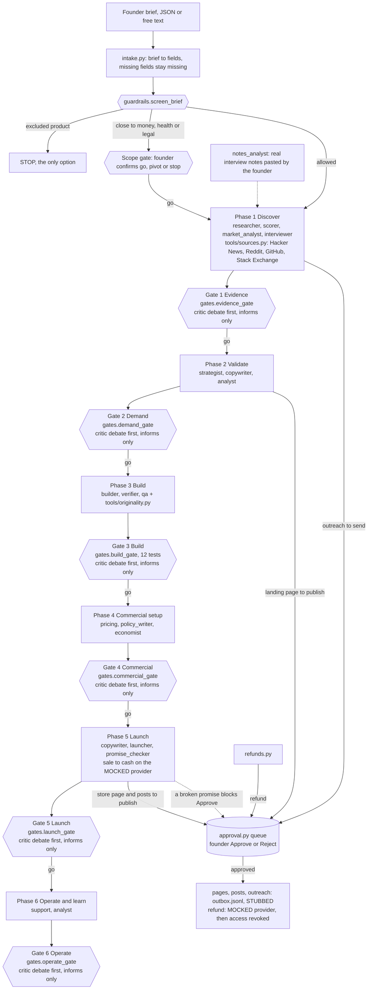
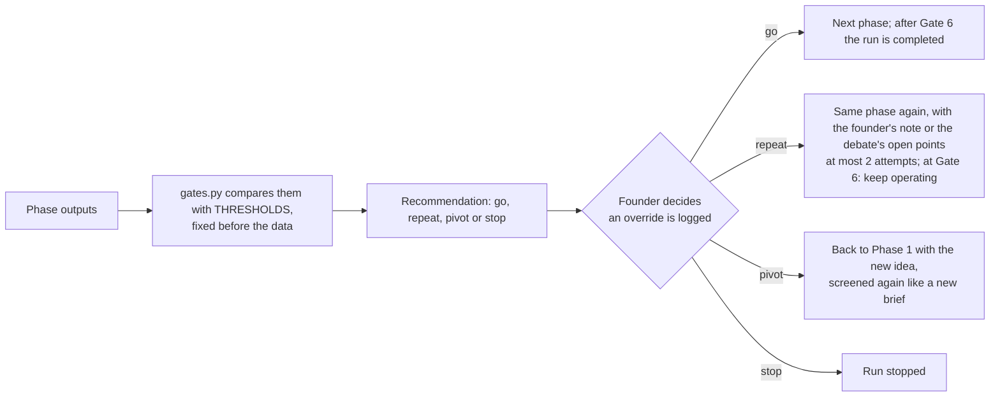
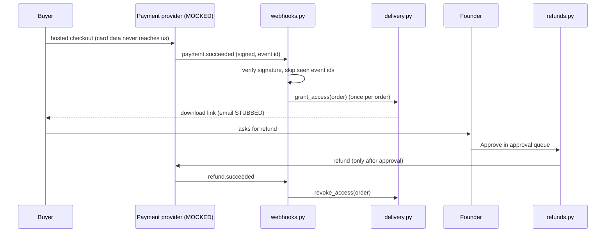

# Architecture

## Overview

Venture Builder is a pipeline of small, role-named agents run by one orchestrator. A founder brief goes in; six phases run one at a time; after each phase a gate measures the results against thresholds fixed in code **before** the data arrives and recommends **go, repeat, pivot or stop**. The run then pauses until the founder decides. Models only write text (ideas, copy, product content). Every decision that matters (scores, gates, tests, prices, payments, approvals) is deterministic code, so it is reproducible and can't be talked into a different answer. Before each gate, a critic agent **debates** the phase's main outputs with the agents that wrote them; the founder sees what was conceded and what is still open, and the recommendation stays with the code. Each kind of work (writer, fast intake, safety judge, critic) has its own model setting. The default is the local Qwen3-4B model for all of them, so it runs on any laptop; `models-large.env` switches the writer to a 30B mixture-of-experts model and the critic to gpt-oss-20b, a different model family. Guardrails screen the brief, every free-text request and every generated text. Every action is appended to the decision log.



What the founder's decision does at any gate (`orchestrator.decide`):



```
Layers
  static/index.html, cli.py      founder interfaces (Go / Repeat / Pivot / Stop, Approve / Reject, interview notes, Ask the team)
  app.py                         HTTP API
  orchestrator.py                phase sequencing, run state, outputs, gate pausing, founder decisions
  agents/<role>.py + prompts/    one agent per role; agents/critic.py runs the debate before each gate
  gates.py  approval.py          decisions and founder control (deterministic)
  guardrails.py  tools/claims.py every brief, request and agent text: safety rules, sources or ASSUMPTION
  tools/originality.py           copied passages and name clashes (Phase 3 QA test)
  tools/honesty.py               removes unbacked counts, founder experience, covert promotion, pause advice against the gate
  payments.py webhooks.py delivery.py refunds.py reconcile.py   sale to cash (provider MOCKED)
  llm.py  tools/sources.py       local models per role (Ollama) and public evidence APIs
  decision_log.py                one JSON entry per agent action
```

## Phases

### Phase 1: Discover (Core step: find opportunities)

- **Agents:** `intake`, `researcher`, `scorer`, `market_analyst`, `interviewer`, `notes_analyst`.
- **Tools:** local model; Hacker News Algolia API, Reddit public JSON, GitHub search (repositories + issues), Stack Exchange API; `guardrails.screen_brief`.
- **Method:**
  1. *Intake* turns a JSON or free-text brief into fields (idea, skills, budget, hours/week, market, values) and refuses excluded products before any agent runs.
  2. *Find opportunities (Core):* the researcher sharpens the starting idea (who, problem, format) and proposes 2 alternatives that fit the founder better. For each it generates 2-4-word problem queries, searches all sources, keeps items whose title/snippet match the idea's keywords (relevance >= 0.34 or 2+ keywords), and tags each item with signals: `pain` (people describing the problem), `willingness_to_pay` (price/pay language), `existing_solution` (repositories). Each item keeps its URL, engagement and author/community. Unsupported problem statements and place names are labelled `ASSUMPTION` ([how evidence is shown](docs/architecture-details.md#evidence-display)).
  3. *Score vs. alternatives:* fixed formulas: demand (log-scaled engagement + pain posts), willingness to pay, competition (popular existing solutions), founder fit (skill match, hours, budget), total. The model only rates skill match, averaged with keyword overlap.
  4. *Define the market:* ideal customer profile, current solutions and gaps, market size only if sourced, otherwise `ASSUMPTION`. Lists where these people talk, from the evidence.
  5. *Interview customers (The Mom Test):* interview guide about past behaviour (no pitching, no "would you buy"), recruiting plan, and an outreach draft queued for founder approval. The system never simulates interview answers.
  6. *Interview notes (optional, when the founder has talked to people):* the founder pastes notes from real conversations into the dashboard. They are stored in the run folder only (`data/`, not in git). The `notes_analyst` separates commitments (time, money, introductions) from compliments. Every quote is checked against the pasted notes and dropped if it is not there word for word; a hypothetical ("I would buy it") is always a compliment. Without a model, keyword rules do the sorting and the output says so. This step informs the founder's decision and does not change the evidence gate.
- **Output:** `phase1_step1_opportunities.md`, `phase1_step2_scorecard.md`, `phase1_step3_market.md`, `phase1_step4_interviews.md`, `phase1_step5_interview-notes.md` (only after the founder adds notes), `phase1_step6_debate.md`, `phase1_gate_decision.md`.

### Phase 2: Validate (Core step: design the business)

- **Agents:** `strategist`, `copywriter`, `analyst`.
- **Tools:** local model; waitlist endpoint `POST /api/waitlist/{run}` (consent required; emails stay in local, git-ignored storage).
- **Method:** *Design the business (Core):* a Lean Canvas (problem, segments, UVP, solution, channels, revenue, costs, key metrics, unfair advantage) built from the evidence, with every guess marked `ASSUMPTION`. The copywriter writes a landing page with a consent-based waitlist form and no testimonials, counters or urgency; publishing it is an approval-gated action. The analyst pre-registers the demand test (default 100 real sign-ups in 14 days) and channels to reach real people without spam or ads. Code (`tools/honesty.py`) keeps only channels found in the evidence and drops covert promotion, fake urgency and unstated founder experience.
- **Output:** `phase2_step1_lean-canvas.md`, `phase2_step2_landing-page.html`, `phase2_step3_demand-test.md`, `phase2_step4_debate.md`, `phase2_gate_decision.md`.

### Phase 3: Build (Core step: build the product)

- **Agents:** `builder`, `verifier`, `qa`.
- **Tools:** local model; in-memory SQLite (`sqlite3`) to execute SQL examples; deterministic test suite in `agents/qa.py`.
- **Method:** *Build the product (Core):* the builder writes an MVP spec sized to the founder's hours (3-4 modules, out-of-scope list, acceptance criteria), then the product itself: per module an intro, numbered steps, a worked example, a checklist and common mistakes; then a user guide (how to use, what you need, getting help, refunds). Links that were never fetched are removed from buyer-facing text ([detail](docs/architecture-details.md#evidence-display)). Founder feedback from a "repeat" decision is fed into the rebuild.
- **Verifier:** after each module is written, a verifier lists its factual errors with exact quotes, SQL examples are executed in SQLite, and code reports format slips; a module with errors is revised once. Detail: [docs/architecture-details.md](docs/architecture-details.md#module-verifier).
- **QA:** 12 deterministic tests: all modules present, >= 120 words each, numbered steps, checklists, no income promises / fake proof / urgency, no placeholder text, user guide sections, allowed category, readable sentence length, package builds (hash), no errors left open by the verifier's last review of any module, and originality.
- **Originality guard** (`tools/originality.py`, code): the product must not copy the sources read in Phase 1 or take an existing product's name. Detail: [docs/architecture-details.md](docs/architecture-details.md#originality-guard).
- **Output:** `phase3_step1_spec.md`, `phase3_step2_product.md`, `phase3_step3_user-guide.md`, `phase3_step4_qa-report.md`, `phase3_step5_debate.md`, `phase3_gate_decision.md`.

### Phase 4: Commercial setup (Core step: set the price and policies)

- **Agents:** `pricing`, `policy_writer`, `economist`.
- **Tools:** price extraction from cited evidence; templates.
- **Method:** *Set the price (Core):* anchor = median of prices found in cited sources (else a labelled `ASSUMPTION` by format), x0.8 for a new product, x0.8 again if the founder values affordability, clamped to $5-$49; the model writes the rationale and one price experiment with a pre-set threshold. No fake "was $X" anchors or countdown discounts. *Set the policies (Core):* draft terms of sale, privacy notice and refund policy (14 days, access revoked on refund, refunds approved by the founder), marked DRAFT / not legal advice. No payments of any kind in this phase. *Unit economics:* the economist (`agents/economist.py`, code, no model) works out what each sale keeps on average after the payment fee (the same fee model as the MOCKED provider) and an assumed 10% refund rate, both labelled `ASSUMPTION`; how many sales cover the founder's budget; and, only if the brief gives the optional `hourly_rate_usd`, how many sales a month pay for the founder's weekly hours. If either number is more than the Phase 2 demand target, the gate shows a warning: even if every sign-up bought, it would not be enough. It never forecasts sales or income, and it does not change the gate's recommendation.
- **Output:** `phase4_step1_pricing.md`, `phase4_step2_policies.md`, `phase4_step4_unit-economics.md`, `phase4_step5_debate.md`, `phase4_gate_decision.md`.

### Phase 5: Launch (Core steps: open the store; deliver automatically)

- **Agents:** `copywriter`, `launcher`, `promise_checker`.
- **Tools:** `payments.py` (MOCKED provider), `webhooks.py`, `delivery.py`, `refunds.py`, `reconcile.py`, `approval.py`.
- **Method:** *Open the store (Core):* store page with price, contents, refund terms and a MOCKED checkout button; launch posts per community, written in the founder's voice for them to post. Each post is a separate model call for one community; code drops a post that still shares a sentence with another post (or pastes the problem statement) after one rewrite, and posts go only to communities found in the evidence that allow sharing your own work (Show HN, never GitHub or Stack Exchange), otherwise the output points to the founder's own network. Code (`tools/honesty.py`) first removes counts, formats and founder experience the product or brief cannot back ([detail](docs/architecture-details.md#promise-checker)). Each page and post is an approval-gated action; after approval it goes to the outbox (STUBBED), never to the internet. *Deliver automatically (Core):* the launcher runs the full sale-to-cash flow against the MOCKED provider with two test buyers and checks 11 properties (see [Sale to cash](#sale-to-cash)).
- **Promise checker:** before the founder approves anything, every promise on the store page and in each post is checked against the product, the price, the refund policy and the delivery test; an item with a broken promise cannot be approved. Detail: [docs/architecture-details.md](docs/architecture-details.md#promise-checker).
- **Output:** `phase5_step1_store-page.html`, `phase5_step2_launch-posts.md`, `phase5_step3_delivery-test.md`, `phase5_step4_promise-check.md`, `payment_test_log.md`, `phase5_step5_debate.md`, `phase5_gate_decision.md`.
- **Order:** in Phase 5 the debate runs before the promise checker (its file is numbered step 5 because the promise check keeps step 4). A correction the debate writes into the store page or a post is also applied to the pending approval item and to the copy the promise checker reads, so the founder approves, and the checker checks, the corrected text.


### Phase 6: Operate and learn

- **Agents:** `support`, `analyst`.
- **Method:** support kit (FAQ, reply drafts signed by the founder, escalation rules: refunds, payments and legal always go to the founder); metrics that separate real numbers (waitlist, real orders) from MOCKED test numbers, which never count; a persevere-or-pivot memo built from the gate history. Its "Evidence for" and "Evidence against" lists are built by code from the facts (gate outcomes and overrides, real buyers, real sign-ups, refund rate; MOCKED numbers excluded), a missing or zero fact always counts against, the model writes only a short reasoning paragraph with no numbers, and the code-built lists are not debated. Code drops pause advice the gate does not support and cut-off sentences.
- **Output:** `phase6_step1_support.md`, `phase6_step2_metrics.md`, `phase6_step3_persevere-or-pivot.md`, `phase6_step4_debate.md`, `phase6_gate_decision.md`.

## Gates

Every phase ends with a gate. Thresholds live in `gates.THRESHOLDS`, are fixed before the data arrives, and change only through a visible code change. The gate recommends; the founder decides (`orchestrator.decide`, founder only); overrides are logged. "Repeat" is offered at most twice per phase, then the founder must choose go, pivot or stop.

| Gate | Type | Checks | Outcomes |
|---|---|---|---|
| Scope check (before 1) | founder | only for an idea close to an excluded category (money, health, legal): nothing is researched or written until the founder confirms it gives no advice | **go** (confirmed, logged) / **pivot** (reword; the new idea is screened again) / **stop** |
| 1 Evidence | evidence | >= 5 relevant sources, >= 4 independent voices, >= 2 pain posts, demand >= 40, founder fit >= 50, total >= 50, allowed category | **go** if all pass; **pivot** to an alternative that passes; **repeat** with broader queries if no candidate has enough evidence either way (or sources were unreachable); otherwise **stop** |
| 2 Demand | evidence | Lean Canvas complete; real waitlist sign-ups vs. pre-registered target (default 100 in 14 days) | **go** at target; **repeat** while the window is open or the test hasn't run; **pivot/stop** below 50% at the end |
| 3 Build | tests | all 12 MVP tests pass, including no errors left open by the verifier and the originality check | **go** / **repeat** (rebuild with feedback) |
| 4 Commercial | founder | price with rationale, three policies drafted, no guardrail violations left; unit economics warnings are shown as reasons, not checks | **go** / **repeat** |
| 5 Launch | founder | sale-to-cash tests pass; every page/post approved or rejected | **go** / **repeat** |
| 6 Operate | evidence | >= 10 real buyers to judge; refund rate < 15% | **go** (persevere) / **repeat** (keep operating, review later) / **pivot** |

**When the system recommends STOP:** the starting idea fails the evidence thresholds and no alternative passes; a second, broader search still finds no public evidence of the problem (absence of evidence first triggers a repeat, not a verdict); the product is in an excluded category (STOP is then the only option); or the waitlist ends below 50% of target on the second attempt. Example from the brief: target 100 sign-ups in 14 days, got 12 → pivot, then stop, never "almost there" (`tests/test_gates.py::test_waitlist_12_of_100_is_not_spun`). The committed demo shows a weak idea (a paid daily quotes email for developers, 2 h/week, $0) stopped at gate 1: `outputs/phase1_gate_decision_weak-idea.md`.

### Debate before each gate

Before each gate a critic agent challenges the phase's main documents and their author agents answer: concede with a correction, or defend with a fetched source. Code keeps only objections that quote the document, writes a conceded correction into the document only when it passes the guardrails, the claim checker and the honesty checks, and labels every objection fixed, conceded not applied, defended or open on the gate card. The debate informs the founder and never changes the gate's recommendation. Full rounds, checks and statuses: [docs/architecture-details.md](docs/architecture-details.md#debate-before-each-gate).

### Safety layers around every gate

Secret redaction, brief screening (excluded products, hidden instructions, the scope check for borderline ideas), request rules in 14 categories, a model second opinion on requests and on drafts that can only add refusals, an output scan on every agent text, the claim checker, and the founder lock in `approval.py`. Evals: a 255-case regression set and 40 held-out prompts the rules were never tuned on ([`evals/results.md`](evals/results.md)). Every layer, with its file: [docs/architecture-details.md](docs/architecture-details.md#safety-layers-around-every-gate).

## Sale to cash



- **Payment triggers delivery:** only a verified `payment.succeeded` webhook marks an order paid and calls `delivery.grant_access`; unpaid orders raise `PermissionError`.
- **A refund revokes access:** `refund.succeeded` sets the order to refunded and deactivates the download token.
- **Idempotency prevents double delivery:** event-level (each event id processed once) and order-level (an order with active access is never delivered again, even if the provider retries with a new event id). Forged signatures are rejected.
- **Refunds need the founder:** `refunds.issue_refund` raises `ApprovalRequired` unless the founder approved the refund action; agents cannot approve.
- **Reconciliation** (`reconcile.py`): every paid order has exactly one charge, every refunded order exactly one refund, no access without a paid order, and payouts = gross - refunds - fees. Mismatches are reported, never auto-fixed.
- Test: `phase5_step3_delivery-test.md`, `outputs/payment_test_log.md`, `tests/test_payments.py`. The simulated founder approval inside this sandboxed test is logged to a separate sandbox log, never to the real decision log.

## Data flow

```
brief (JSON/text) -> intake -> run state  data/runs/<id>/state.json   (git-ignored)
  phase steps -> outputs  data/runs/<id>/outputs/phase<N>_step<M>_<name>.<ext>
  phase outputs -> critic <-> authors -> phase<N>_step<M>_debate.md + gate card (the gate itself is unchanged)
                   decision log: critic/debate_challenge, <author>/debate_response, <author>/apply_debate_correction, critic/debate_verdict
  each model call -> role (writer / fast / judge / critic) -> its model, or the next one if it cannot load
  every action -> decision log  (timestamp, agent, action, sources[], model, cost, approved_by, + run_id, outcome)
  price + budget + hours/week + demand target -> economist -> phase4_step4_unit-economics.md + warning on gate 4 (recommendation unchanged)
  store page + posts + product + price + delivery test -> promise checker -> verdict on each approval item
  outbound drafts -> approval queue (run state) -> founder Approve (refused if a promise is broken) -> outbox.jsonl (STUBBED)
  waitlist form -> data/runs/<id>/waitlist.json (consented emails, local only) -> demand gate
  public APIs -> cache data/cache (24h) -> evidence with URLs -> scores -> gates
scripts/run_demo.py -> copies the demo runs to outputs/ and their log to decision_log.json
```

Personal data: only consented waitlist emails, stored locally and never logged. No passwords or card numbers anywhere.

## Built vs. stubbed

| Part | Status |
|---|---|
| Orchestrator, six phases, gates, founder decisions, approval queue | Built |
| Guardrails (briefs, requests, outputs), trick-prompt tests | Built |
| Evidence research on public APIs, scoring, market definition | Built |
| Module verifier: model review with quoted errors, one revision, SQL examples executed in SQLite | Built. The SQL execution and format checks are the dependable part. The model review is limited by the small local model: in our tests it found few of the factual slips a human reviewer finds, and it does not look anything up online |
| Lean Canvas, landing page, product build, QA tests, pricing, policy drafts, unit economics, store page, posts, support, metrics, memo | Built |
| Webhooks, idempotent delivery, refunds with approval, reconciliation | Built (against a MOCKED provider) |
| Payment provider / checkout | **MOCKED** |
| Publishing pages and posts, sending outreach, delivery emails | **STUBBED** (outbox) |
| Public hosting of the waitlist page | **STUBBED** (form works on the local app) |
| Customer interviews | **STUBBED** (guide and outreach built; the conversations are the founder's own) |
| Interview notes: commitments vs. compliments, quotes checked against the founder's pasted notes | Built |
| Debate before each gate: critic vs. authors, quotes checked in code, open objections on the gate card | Built |
| One model per role with hand-over to the next model when one cannot load | Built |
| Promise checker: store page and posts matched to the product, price, refund policy and delivery test; broken promises block approval | Built. Without a model, promises that need a quote stay unverifiable |
| Honesty filters (`tools/honesty.py`): unbacked counts and formats, founder experience, covert promotion and urgency, places outside the evidence, pause advice against the gate | Built. Pattern lists, so a new phrasing can get through; they cover sales copy, posts, growth advice and the memo, not the product's own explanations |
| Originality guard: copied passages and name clashes against the fetched evidence | Built. Compares fetched titles and snippets only, not full pages; licences of reused code are not checked yet |

## Roadmap

1. **Next 2 weeks:** interview commitments as an input the founder can weigh at the evidence gate; Arabic-language outputs; more evidence sources (Product Hunt, YouTube comments via public APIs).
2. **Next 2 months:** payment-provider adapter in test mode behind the same webhook/delivery code; publishing adapters (static hosting, social) that still require founder approval per item.
3. **Later:** multi-founder hosting, plug-in agents, a shared library of guardrail trick prompts contributed by users.
