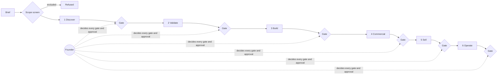

# Venture Gates by The Overfitters

A small team of agents that takes a founder's idea through six gated phases (Discover, Validate, Build, Commercial setup, Sell/deliver/get paid, Operate and learn) toward a sellable **digital** product. One rule keeps it small and honest: **the model writes, code decides.** A small open-weight model (`qwen3:4b`) only drafts text. Scores, gates, prices, approvals and payments are plain Python, about 1,500 lines, with no third-party packages.

Three ideas make it different:

1. **Pre-registered gates.** Gate thresholds are hashed into the decision log *before* any evidence is fetched. Every gate report shows whether the thresholds still match that hash, so nobody (and no model) can move the goalposts after seeing the data.
2. **A red team that tries to kill the idea first.** Fixed "kill questions" (a dominant free tool? stale pain? no founder time?) block GO until the founder answers them with a written, logged reason.
3. **Evidence or nothing.** Every pain on the landing page links the public post it came from, and the Validate gate checks that 100% of them do. A source that fails is listed as failed, never filled in.

## Quickstart

```bash
docker compose up
```

Then open **http://localhost:8000**. Pick a sample brief (or edit the JSON), click **Run Phase 1**, read the gate, and click **Go / Repeat / Pivot / Stop**. Outbound items (publish, post, refund) wait in the **Approval queue**.

- The first start downloads `qwen3:4b` (about 2.5 GB). The dashboard works right away: until the model is ready, agents use deterministic text labelled `TEMPLATE`.
- Without Docker (Python 3.10+, no packages needed): `python app.py`, or the CLI: `python cli.py start briefs/strong_idea.json`.
- Regenerate `outputs/` and `decision_log.json`: `python scripts/run_demo.py`. Tests: `pytest -q`. Guardrail evals: `python scripts/run_evals.py`.

## What works and what is mocked

| Phase | Step | Status |
|---|---|---|
| 1 Discover | Evidence search: GitHub repositories (competitors), GitHub issues and Hacker News (pain voices) | **Working** (free public APIs, no keys) |
| 1 Discover | Scorecard: demand, founder fit, competition (fixed formulas) | **Working** |
| 1 Discover | Red team: kill questions against the evidence | **Working** |
| 1 Gate | Evidence gate, pre-registered thresholds, STOP on weak evidence | **Working** |
| 2 Validate | Value proposition from the 3 strongest recent pains, each linked | **Working** |
| 2 Validate | Landing page with consent-based waitlist form | **Working** (page); form **STUBBED** (not connected) |
| 2 Validate | Pre-registered smoke test and interview guide | **Working**; real sign-ups **STUBBED** (never simulated) |
| 3 Build | Spec, product (Markdown toolkit), QA checks against the spec | **Working** |
| 4 Commercial | Rule-based price, terms / refund / privacy drafts | **Working** |
| 5 Sell | Store page and launch post drafts | **Working** |
| 5 Sell | Publishing pages and posts, delivery emails | **STUBBED** (founder approval required, then written to a local outbox) |
| 5 Sell | Checkout and payment provider | **MOCKED** (signed webhooks, fees; no real money) |
| 5 Sell | Delivery on payment, idempotent webhooks, refund revokes access, reconciliation | **Working** (against the MOCKED provider) |
| 6 Operate | Metrics and support kit | **Working**, on **MOCKED** sale data |
| 6 Gate | Persevere-or-pivot rule | **Working**; refuses to judge MOCKED data (recommends REPEAT until real sales exist) |
| All | Prose from `qwen3:4b` via Ollama | **Working** when the model is running; otherwise `TEMPLATE` text, labelled |

**Where to check each claim**

| Claim | File |
|---|---|
| Strong idea goes through all six phases | [outputs/demo_run_summary.json](outputs/demo_run_summary.json), `outputs/phase1_gate_evidence.md` to `outputs/phase6_gate_operate.md` |
| Weak idea: system recommends STOP | [outputs/phase1_gate_evidence_weak-idea.md](outputs/phase1_gate_evidence_weak-idea.md) |
| Excluded idea refused before any research | [outputs/phase1_gate_scope_excluded-idea.md](outputs/phase1_gate_scope_excluded-idea.md) |
| Founder overrode a PIVOT with a logged reason | [outputs/phase1_gate_evidence.md](outputs/phase1_gate_evidence.md), `decision_log.json` (`"override": true`) |
| Sale to cash: 8/8 checks pass | [outputs/payment_test_log.md](outputs/payment_test_log.md) |
| Nothing leaves without founder approval | [approval.py](approval.py), [tests/test_approval.py](tests/test_approval.py) |
| Guardrails: 33/33 eval prompts | [evals/results.md](evals/results.md) |
| 25 smoke tests | [tests/](tests/) |

The committed demo run (63 log entries) used **no model**: the build machine had no GPU and could not download model weights, so every model step used `TEMPLATE` text and is logged with `"model": null`. Hacker News was also unreachable from that machine; those failures are listed in `outputs/phase1_step1_opportunities.md`, and the evidence comes from GitHub only.

## Architecture

One orchestrator runs the phases in order. Agents do not chat with each other: each one reads and writes a single run file (`data/runs/<id>/run.json`), which keeps every step visible and logged. After each phase a gate in `gates.py` (plain code) recommends go, repeat, pivot or stop, and the run pauses until the founder decides; a decision that differs from the recommendation needs a written reason. Anything outbound goes through `approval.py`, which refuses to act without the founder's approval. Every agent action appends one entry to `decision_log.json`. Details and diagrams: [ARCHITECTURE.md](ARCHITECTURE.md).



## Models and free resources

- **Model:** `qwen3:4b` (open-weight, Apache-2.0) through **Ollama**, started by `docker compose up`. Smaller options: `LLM_MODEL=qwen3:1.7b docker compose up`.
- **No model at all:** `LLM_PROVIDER=none`. Every step still runs, with `TEMPLATE` text, because no decision depends on the model.
- **Evidence:** GitHub search API and Hacker News Algolia API, both free and keyless. An optional `GITHUB_TOKEN` only raises the rate limit.
- **Payments:** a MOCKED provider in `payments.py`. No account or key is needed, and there is no live mode.

## Cost per run

About **$0.00 per run**. The model runs locally (`LLM_COST_PER_MTOK=0`), the evidence APIs are free, and payments are MOCKED. The committed demo log records a total cost of $0 across 63 entries.

## Demo video

No demo video has been recorded yet. The dashboard flow is: pick `strong_idea.json`, Run Phase 1, read the gate, decide, approve the queue.

## What our system will NOT do

- Promise income or success. The guardrails remove such sentences from every text an agent writes.
- Write fake reviews, testimonials, user counts, sign-ups, scarcity or countdown timers.
- Pose as the founder, a customer or another brand. Posts are drafts in the founder's voice and wait for approval.
- Publish, send, spend, refund or sign anything without the founder's click. This is enforced in `approval.py` and `refunds.py`, and tested.
- Hold or move money, create accounts, or store passwords or card numbers. The checkout is MOCKED and hosted by the provider.
- Build physical goods, financial / investment / crypto products, or health or legal advice products. These briefs are refused before any research.
- Judge a business on MOCKED data. The Operate gate waits for real sales.
- Hide features behind a paywall. Everything here is MIT-licensed.

## How the project stays alive after the hackathon

- **Maintainers:** The Overfitters team maintains the repository and reviews pull requests.
- **Roadmap:** a payment-provider adapter in test mode, real waitlist collection, more evidence sources (Reddit, Stack Exchange), interview-notes analysis, and Arabic outputs. See [ARCHITECTURE.md](ARCHITECTURE.md#roadmap).
- **Community:** each agent, evidence source and guardrail rule is one small file or table entry, so contributions are easy to review. New trick prompts become eval cases.
- **Funding:** the software stays free and complete. Possible support: university and incubator partnerships, open-source grants, and optional paid setup help.
