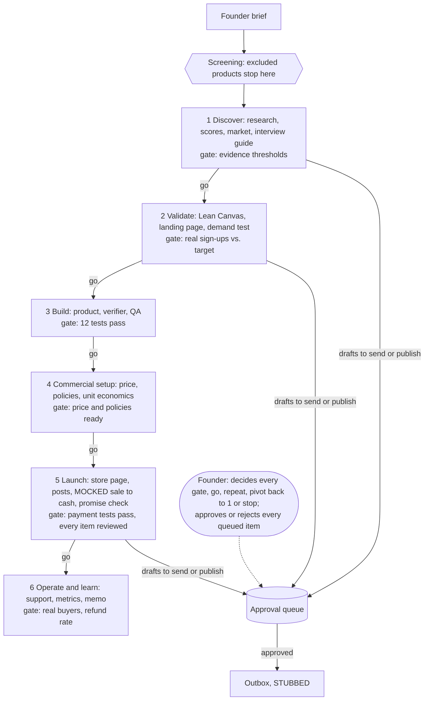

# Venture Builder by The Overfitters

Most AI business tools promise income, lock founders into closed platforms and stop at a generic plan. **Venture Builder is the honest, open alternative** for a first-time founder with a skill, a few hours a week and a small budget, who needs to know whether an idea is worth building before spending on it. An open-source team of AI agents takes the founder's brief through six gated phases (Discover, Validate, Build, Commercial setup, Launch, Operate and learn) using proven methods: Mom Test interviews, a Lean Canvas and a demand test with a target set in advance. Every market claim cites a fetched source or is labelled `ASSUMPTION`, and the system says **"don't launch this"** when the evidence is weak. **Why open beats closed:** it runs on free open-weight models on the founder's own machine for $0.00, every gate threshold is readable code in [`gates.py`](gates.py), and nothing is published, sent, spent or refunded without the founder's click, enforced in [`approval.py`](approval.py).

**The committed demo run** ([`scripts/run_demo.py`](scripts/run_demo.py), local open-weight models) shows the three outcomes that matter, plus a brief the pipeline was never tuned on:

- **Promising idea, GO:** an SQL interview workbook passes the evidence gate on 25 relevant sources, 25 independent voices and 5 pain posts ([gate](outputs/phase1_gate_decision.md)), passes 12 of 12 build tests ([report](outputs/phase3_step4_qa-report.md)) and reaches a [MOCKED sale-to-cash test](outputs/payment_test_log.md). The demand gate recommended repeat because no real visitor has seen the page; the demo founder overrode it to show the later phases, and the override is recorded ([gate](outputs/phase2_gate_decision.md)).
- **Weak idea, STOP:** a paid daily-quotes email for developers fails on founder fit and total score, and no alternative passes ([gate](outputs/phase1_gate_decision_weak-idea.md)).
- **Excluded idea, refused:** a crypto-signals channel is refused before any agent runs ([gate](outputs/phase1_gate_decision_excluded-idea.md)).
- **Unseen brief:** a Figma case-study template pack for junior UX designers passes the evidence gate on 14 relevant sources and 3 pain posts, all from one platform ([gate](outputs/phase1_gate_decision_designer-idea.md)); the demand gate recommended repeat and then stop, because no real visitor has seen the page, and the founder accepted it ([gate](outputs/phase2_gate_decision_designer-idea.md)).

**Measured, not claimed:** 502 tests that run with no model or network, on every push ([CI](.github/workflows/ci.yml)); guardrails refuse 37 of 40 trick prompts they were never tuned on (rules alone: 2 of 40) and wrongly refuse 0 of 65 normal requests ([`evals/results.md`](evals/results.md)); Phase 1, including its debate, took 64 seconds on an NVIDIA RTX 4080 in the committed run; $0.00 per run.

| Claim | Where to check it |
|---|---|
| STOP on weak evidence, thresholds fixed in advance | [weak-idea gate](outputs/phase1_gate_decision_weak-idea.md), [`gates.py`](gates.py) (`THRESHOLDS`) |
| Nothing goes out without the founder | [`approval.py`](approval.py), [`tests/test_approval.py`](tests/test_approval.py) |
| Every market claim sourced or `ASSUMPTION` | [opportunities](outputs/phase1_step1_opportunities.md), [market](outputs/phase1_step3_market.md), [`tools/claims.py`](tools/claims.py) |
| 12 deterministic build tests, originality included | [QA report](outputs/phase3_step4_qa-report.md), [`agents/qa.py`](agents/qa.py) |
| Store-page and post promises matched to the product: 11 checked, 10 kept, 0 broken, 1 for the founder to confirm | [promise check](outputs/phase5_step4_promise-check.md) |
| A critic challenges each phase before its gate: 9 objections across the SQL run's six debates, 5 corrected in the documents, 3 conceded but not applied, 1 open (example from Phase 5: a store-page claim that the questions are commonly asked in Egypt and the MENA region, which no source shows, was rewritten; other regional wording on the page was not challenged) | [Phase 5 debate](outputs/phase5_step5_debate.md), [`agents/critic.py`](agents/critic.py) |
| Payment triggers delivery, refunds revoke access, books reconcile (MOCKED provider) | [payment test log](outputs/payment_test_log.md), [`tests/test_payments.py`](tests/test_payments.py) |
| Every agent action logged with sources, model, cost and approver | [`decision_log.json`](decision_log.json) |

## Quickstart

```bash
docker compose up
```

Then open **http://localhost:8000**, pick a sample founder (or paste any brief) and click **Run Phase 1**. After each phase, read the gate's recommendation and click **Go / Repeat / Pivot / Stop**; launch items wait in the **Approval queue** for Approve / Reject.

- The first start downloads the default model (`qwen3:4b-instruct-2507-q4_K_M`, about 2.5 GB) once; until it is ready the dashboard says so and the agents use a labelled deterministic fallback.
- Larger models (32+ GB RAM or a GPU): `docker compose --env-file models-large.env up`. NVIDIA GPU: add `-f docker-compose.yml -f docker-compose.gpu.yml`. Slow laptop: `LLM_MODEL=qwen3:1.7b docker compose up`.
- Command line: `docker compose run --rm app python cli.py run briefs/strong_founder.json`. Tests: `docker compose run --rm app pytest -q`. Regenerate `outputs/` and `decision_log.json`: `docker compose run --rm app python scripts/run_demo.py`.

## What works and what is mocked

| Phase | Step | Status |
|---|---|---|
| 1 Discover | Sharpen the idea, 2 alternatives, public evidence (Hacker News, Reddit, GitHub, Stack Exchange; each run reports which sources answered) | **Working** (committed run: Hacker News and GitHub answered, Reddit 403, Stack Exchange 429) |
| 1 Discover | Score vs. alternatives (fixed formulas); define the market (sourced or `ASSUMPTION`) | **Working** |
| 1 Discover | Mom Test interview guide; founder's real notes sorted into commitments vs. compliments | **Working** |
| 1 Discover | Sending outreach / running interviews | **STUBBED** (the founder does it; answers are never simulated) |
| 1 Gate | Evidence gate with pre-set thresholds, recommends STOP on weak evidence | **Working** |
| 2 Validate | Lean Canvas; landing page with a consent-based waitlist form; demand-test plan | **Working** |
| 2 Validate | Publishing the landing page | **STUBBED** (approval-gated, saved to outbox) |
| 2 Gate | Demand gate: pre-registered sign-up target, real sign-ups only | **Working** |
| 3 Build | MVP spec, product, user guide; verifier (facts, SQL run in SQLite); originality guard | **Working** |
| 3 Gate | 12 deterministic MVP tests, all must pass | **Working** |
| 4 Commercial | Rule-based price from sourced comparables, or a labelled `ASSUMPTION` anchor when none is found (the committed run found none); draft terms, privacy and refund policy | **Working** |
| 4 Commercial | Unit economics: what each sale keeps and how many sales cover the budget; arithmetic only, no forecast | **Working** (fee and refund rate labelled `ASSUMPTION`) |
| 5 Launch | Store page and launch posts for the founder to post; unbacked claims removed by code; promise checker | **Working** |
| 5 Launch | Publishing the store page and posts | **STUBBED** (approval-gated, saved to outbox) |
| 5 Launch | Checkout and payment provider | **MOCKED** (no payments of any kind) |
| 5 Launch | Automatic delivery, idempotent webhooks, refunds revoke access, reconciliation | **Working** (against the MOCKED provider) |
| 5 Launch | Delivery emails | **STUBBED** (recorded, not sent) |
| 6 Operate | Support kit, metrics (real and MOCKED kept apart), persevere-or-pivot memo | **Working** |
| All | Guardrails on briefs, requests and every output; scope check; secret redaction | **Working** |
| All | Critic debate before each gate; claim check; decision log; founder approval | **Working** |

## Architecture

An **orchestrator** ([`orchestrator.py`](orchestrator.py)) runs the six phases in order; each phase is a few role-named agents (`agents/<role>.py`, prompts in `prompts/`) that call local models through `llm.py` and free public evidence APIs through `tools/sources.py`. After every phase a **gate** ([`gates.py`](gates.py)) compares the results with thresholds fixed in code before the data arrives and recommends go, repeat, pivot or stop; the run pauses until the founder decides. Before each gate a **critic** ([`agents/critic.py`](agents/critic.py)) challenges the phase's documents, and only corrections that pass the safety checks are written into them. Anything outbound goes through [`approval.py`](approval.py), [`guardrails.py`](guardrails.py) screens briefs, requests and every generated text, and every agent action is appended to [`decision_log.json`](decision_log.json). Full design, diagrams and the sale-to-cash flow: [ARCHITECTURE.md](ARCHITECTURE.md).



## Models and free resources

- **Default:** `qwen3:4b-instruct-2507-q4_K_M` (Qwen3-4B-Instruct-2507, Apache-2.0, open weights) for every role, served by **Ollama** and downloaded by `docker compose up`; fallbacks `qwen3:4b-instruct`, `qwen3:4b`, `qwen3:1.7b`.
- **Committed demo run:** `qwen3:30b-a3b-instruct-2507-q4_K_M` for writing, `gpt-oss:20b` as the critic, and the 4B model for intake and the safety judges, on an NVIDIA RTX 4080 via [`models-large.env`](models-large.env). All Apache-2.0. Roles and settings: [docs/models.md](docs/models.md).
- **No paid service is required.** Optionally, any free-tier OpenAI-compatible endpoint serving an open-weight model (`LLM_PROVIDER=openai_compatible`). Without any model (`LLM_PROVIDER=none`) agents use labelled deterministic templates, logged as `"model": null`.
- **Evidence:** free public APIs with no keys (Hacker News, Reddit, GitHub, Stack Exchange); an optional free `GITHUB_TOKEN` raises GitHub's rate limit. Each run reports per source what worked: in the committed run Reddit refused the requests (HTTP 403) and Stack Exchange rate-limited them (HTTP 429), so the evidence comes from Hacker News and GitHub only ([source coverage](outputs/phase1_step1_opportunities.md#source-coverage)).
- **Decisions don't depend on the model:** scores, gates, build tests, pricing and payments are deterministic code.
- **Development tools:** built with Claude Code as a development assistant; the product runtime uses only open-weight models via Ollama, with no paid API calls.

## Cost per run

**About $0.00 per run** (local models; ~81k tokens and 56 model calls for all four demo founders in the committed run; research APIs are free). The dashboard header shows the running cost; how the decision log counts model entries: [docs/models.md](docs/models.md#cost-per-run).

## Demo video

Demo video: https://drive.google.com/file/d/1_flIP4f2UaXU5lvi1eR81f5lqV7ubHwC/view?usp=sharing

## What our system will NOT do

- Promise income, earnings or success, in any text it writes.
- Write reviews, testimonials, ratings or customer quotes, or invent sign-ups, users or sales numbers.
- Use countdown timers, fake scarcity or pressure tactics.
- Pose as the founder, a customer or another brand. Drafts are for the founder to send as themselves.
- Publish, send, spend, sign or refund anything without the founder's explicit approval.
- Hold, move or refund money by itself, create accounts, or store passwords or card numbers.
- Build physical goods, financial / investment / crypto products, or health or legal advice products.
- Put core features behind a paywall.
- Let a model's opinion move a gate: the debate before each gate informs the founder; the recommendation comes from fixed thresholds in code.
- Spin weak evidence: a missed target is reported as missed, with a pivot or stop recommendation.
- Move a gate's threshold after seeing the data, or pretend a gate passed.

These limits are code (`guardrails.py`, `approval.py`, `gates.py`). The rule layer is tested by `tests/` on 258 cases in `evals/trick_prompts.json`; 40 prompts the rules have never seen are in `evals/heldout_prompts.json` and are measured together with the model's second opinion by `python scripts/run_evals.py --deep` ([`evals/results.md`](evals/results.md), including the 3 that get through).

## How the project stays alive after the hackathon

- **Maintainers:** The Overfitters (Ahmed Monir, Beshoy Maher, Omar Abdelhady, Ahmed Ayman); contributions are reviewed through pull requests.
- **Roadmap:** real payment-provider adapter in test mode, hosted landing pages with founder approval, more evidence sources, and Arabic-first outputs. See the roadmap in [ARCHITECTURE.md](ARCHITECTURE.md#roadmap).
- **Community:** MIT-licensed; new agents, evidence sources and guardrail tests are easy to add (one file each), as described in [CONTRIBUTING.md](CONTRIBUTING.md). Trick prompts from users become new tests; a test keeps held-out prompts from being copied into the rules or the judge prompts.
- **Funding:** the software stays free and fully featured. Possible support: university and incubator partnerships, open-source grants, and optional paid hosting or setup help for founders who don't want to self-host. Core features are never paywalled.
